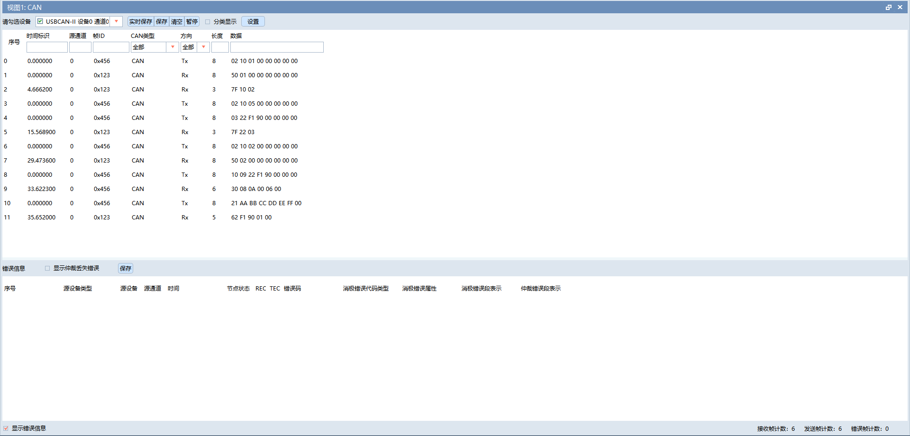

# RT-UDS: 基于 RT-Thread 的工业级 CAN 诊断协议栈 (V1.0)

[](https://opensource.org/licenses/Apache-2.0)
[](https://www.rt-thread.org/)
[](https://www.st.com/)

## 1. 项目简介
本项项目是基于 **RT-Thread** 实时操作系统开发的 UDS (ISO 14229) 诊断方案。实现了符合 **ISO 15765-2** 标准的传输层协议 (ISO-TP)，能够处理单帧、多帧传输及流控管理。该协议栈具备高可靠性、低内存占用和易移植性，适用于车载 ECU 升级及传感器诊断终端。

---

## 2. 技术栈
*   **内核**: RT-Thread Standard 版本 (信号量、线程调度、定时器)
*   **硬件**: STM32F103 系列 (配备 TJA1050 CAN 收发器)
*   **外设**: 双路 CAN 控制器
*   **协议规范**: 
    *   应用层：UDS (ISO 14229)
    *   传输层：ISO-TP (ISO 15765-2)
    *   物理层：CAN 2.0A/B

---

## 3. 核心特性
*   **健壮的 TP 层**: 完整支持 SF(单帧)、FF(首帧)、FC(流控) 及 CF(连续帧)
*   **高效驱动设计**: 采用 **RingBuffer + Semaphore** 机制。中断层仅负责入队，业务层异步处理
*   **表驱动 DID 管理**: 采用结构体索引表管理数据标识符 (DID)，新增诊断项仅需在表中注册，实现业务逻辑解耦。
*   **交互式控制台**: 深度集成 RT-Thread **Finsh** 命令行，支持在线发送诊断请求、会话状态切换及实时日志分析。

---

## 4. 项目结构
```text
Project_Root/
├── applications/       # 应用层逻辑 (main.c)
├── drivers/            # 底层硬件驱动 (drv_can.c)
├── protocol/           # 核心协议栈
│   └── uds/
│       ├── inc/        # 协议栈头文件 (uds_tp.h, uds_config.h)
│       └── src/        # 传输层与服务层实现 (uds_tp.c)
├── docs/               # 演示图片
└── README.md           # 项目说明
```

---

## 5. 快速上手

### 5.1 编译说明
项目基于 **RT-Thread Studio** 开发：
1.  在 RT-Thread Studio 中导入本工程。
2.  确保已安装适配 STM32F103 的工具链及资源包。
3.  点击工具栏的 **Build** 图标（或快捷键 `Ctrl + B`）进行工程编译。

### 5.2 操作指令
通过串口终端连接设备，使用 Finsh 控制台进行交互：

```bash
# 1. 开启诊断接收线程
msh /> Can_receive_sample

# 2. Can分析仪发送测试数据

```

---

## 6. 诊断服务清单

### 支持的服务 (SID)
| SID | 服务名称 | 功能描述 |
| :--- | :--- | :--- |
| **0x10** | DiagnosticSessionControl | 支持默认、编程、扩展会话切换 |
| **0x11** | ECUReset | 支持复位响应 |
| **0x22** | ReadDataByIdentifier | 支持版本号、序列号、传感器数据读取 |

### 响应码 (NRC) 覆盖
项目完整支持以下负响应码，确保诊断交互过程符合标准逻辑：
- `0x11`: ServiceNotSupported
- `0x12`: SubFunctionNotSupported
- `0x13`: IncorrectMessageLength
- `0x22`: ConditionsNotCorrect
- `0x31`: RequestOutOfRange

---

## 7. 测试结果演示
以下为通过 CAN 盒模拟上位机与本设备交互的抓包测试结果：



---
 